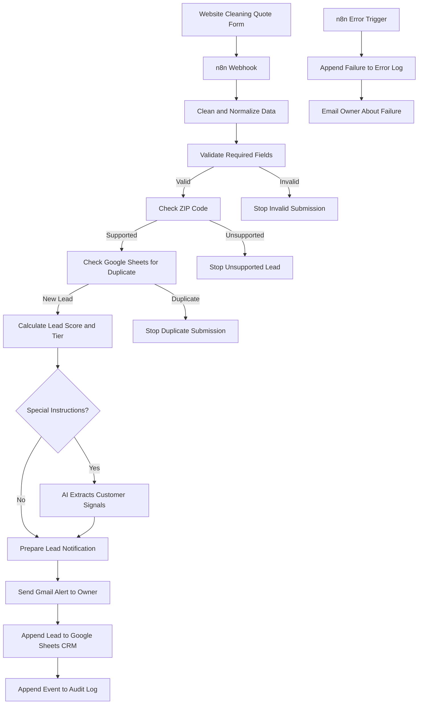

# Cleaning Lead Capture & Qualification — V2

An n8n automation system for residential cleaning businesses that captures website quote requests, validates and qualifies leads, prioritizes new enquiries, stores customer records in Google Sheets, and alerts the business owner by email.

> **Portfolio project:** This repository documents a demonstration build. It is not presented as a verified client deployment or as evidence of measured business results.

## Overview

Residential cleaning companies can spend significant time reviewing quote requests, checking service locations, identifying duplicate enquiries, organizing customer details, and deciding which leads need attention first.

This system automates the lead-intake and qualification process. A customer submits a cleaning enquiry through a website form. n8n processes the submission, checks whether it is complete and eligible, checks for duplicates, assigns a lead priority, optionally extracts useful details from special instructions with AI, stores the new lead, and sends the owner a structured Gmail notification.

The project contains **two n8n workflows**:

1. **Main Lead Capture & Qualification** — processes new cleaning enquiries.
2. **Error Handler** — records workflow failures in Google Sheets and emails the owner.

## Key Features

- Website form submission received through an n8n webhook.
- Data cleaning and normalization before processing.
- Required-field validation and conditional routing.
- ZIP-code service-area verification.
- Duplicate detection using customer email or phone number.
- JavaScript-based lead scoring and HIGH / MEDIUM / LOW classification.
- Conditional AI extraction from customer special instructions, including pets, allergies, urgency, and access notes.
- Formatted Gmail notification with customer details, lead priority, recommended next action, and extracted signals.
- Google Sheets CRM storage, audit logging, and error logging.
- Separate n8n error workflow that alerts the owner when an execution fails.

## Architecture



## Main Workflow: Lead Capture & Qualification

The main workflow follows this sequence:

1. **Receive form data** — the webhook receives a cleaning quote request.
2. **Clean and format data** — incoming fields are converted into consistent, readable values.
3. **Validate required fields** — checks the required customer and service information.
4. **Route invalid submissions** — invalid submissions stop; valid submissions continue.
5. **Check service area** — checks the customer's ZIP code against the configured service-area rules.
6. **Route by service-area result** — supported ZIP codes continue; unsupported ZIP codes stop.
7. **Check for duplicates** — searches the Google Sheets CRM using email or phone.
8. **Route duplicate results** — duplicate submissions stop; new leads continue.
9. **Classify the lead** — JavaScript calculates a score and assigns a priority tier.
10. **Check special instructions** — determines whether the customer added notes.
11. **Extract AI signals when notes exist** — identifies useful details such as pets, allergies, urgency, and access notes.
12. **Notify the owner** — Gmail sends a formatted HTML alert with the lead details and recommended next action.
13. **Save the lead** — the new record is appended to the Google Sheets `Leads` tab.
14. **Record the audit event** — successful processing is recorded in the `Audit Log` tab.

The project brief describes the main workflow as a 14-node workflow. Node labels and the exact node count can vary if the workflow is revised; use the current n8n export as the source of truth for an installed copy.

### Lead Scoring

The project uses the following documented score bands:

| Score | Priority | Recommended next action |
| ---: | --- | --- |
| 80 or higher | **HIGH** | Call within 2 hours |
| 50–79 | **MEDIUM** | Send a quote within 24 hours |
| Below 50 | **LOW** | Send a standard follow-up email |

The score is based on service type, number of bedrooms, number of bathrooms, and cleaning frequency. The exact point values assigned to each input are defined by the workflow's scoring logic; they are not specified in this README.

These are **recommended actions for the business owner**, not a claim that the workflow automatically calls customers or sends quotes.

### AI Special-Instruction Extraction

When a customer provides additional notes, the workflow can use an AI step to identify useful information for the cleaning team, for example:

- Pets in the home.
- Allergies or cleaning-product restrictions.
- Urgent requirements.
- Property access notes.

AI is used to structure customer-provided information. It does **not** generate or approve cleaning prices, confirm availability, or book appointments.

## Error Handler Workflow

A separate workflow named `1.2 Error Handler` is designed to:

1. Catch workflow execution failures.
2. Append the failure details to the Google Sheets `Error Log`.
3. Send the owner a Gmail alert.

The visible error-log fields include:

| Field | Purpose |
| --- | --- |
| Timestamp | When the failure was recorded |
| Workflow | Workflow where the error occurred |
| Node | Node associated with the failure |
| Error Message | Error details returned by the execution |
| Execution ID | Identifier for investigating the execution |

The supplied demonstration screenshots include examples of test execution errors. Their presence in the log does not mean every listed issue is currently active or that every failure scenario has been resolved.

## Google Sheets CRM

The workbook shown in the project screenshots includes these tabs:

- `Leads` — customer enquiries and qualification details.
- `Audit Log` — successful processing events.
- `Error Log` — workflow failures captured by the error handler.
- `Estimates`, `Errors tab`, and `Dashboard` — additional workbook tabs visible in the supplied CRM workbook.

The visible `Leads` columns include name, email, phone, ZIP code, service type, bedrooms, bathrooms, frequency, and preferred date. The project specification describes **15+ CRM columns** overall, including additional qualification, consent, AI-extraction, and review information.

## Technology Stack

| Technology | Role |
| --- | --- |
| **n8n** | Workflow orchestration and integrations |
| **JavaScript** | Data normalization, validation, conditional logic, and lead scoring |
| **Website form + webhook** | Captures quote requests and starts the workflow |
| **Google Sheets** | CRM records, audit events, and error logs |
| **Gmail** | Owner notifications and error alerts |
| **AI / LLM integration** | Extracts structured signals from special instructions |

The exact AI provider and form platform should match the credentials and integrations configured in the current n8n workflow.

## Setup and Configuration

This repository README describes the workflow. To run your own instance, you will need access to n8n and the connected services used by your workflow.

1. **Import the workflows** into your n8n instance using the workflow JSON exports.
2. **Configure credentials** for Google Sheets, Gmail, and the AI provider used by the AI extraction node.
3. **Configure the form webhook** and connect the website form to the n8n webhook URL.
4. **Set the service-area rules** using the cleaning company's approved ZIP-code list.
5. **Check the lead-scoring logic** and make sure the weights and priority actions reflect the company's requirements.
6. **Map the Google Sheets columns** to the fields used by the Leads, Audit Log, and Error Log append nodes.
7. **Configure the error workflow** and select the main workflow(s) it should monitor.
8. **Activate the workflows** only after credentials, mappings, and test cases have been checked.

### Credentials and Security

- Use your own service credentials; do not commit API keys, OAuth tokens, passwords, or webhook secrets to GitHub.
- Store credentials in n8n's credential manager.
- Use fictional data for public demonstrations and testing.
- Give integrations only the access they need.
- Confirm the client's data-handling, retention, and access requirements before using real customer information.

## Testing Checklist

Before using this workflow with real enquiries, test at least the following cases:

- [ ] Valid new lead in a supported ZIP code.
- [ ] Missing or invalid required information.
- [ ] ZIP code outside the configured service area.
- [ ] Duplicate email address.
- [ ] Duplicate phone number.
- [ ] HIGH, MEDIUM, and LOW scoring scenarios.
- [ ] Special instructions containing pets, allergies, urgency, or access details.
- [ ] No special instructions supplied.
- [ ] Successful CRM, Audit Log, and Gmail actions.
- [ ] Main-workflow failure is recorded by the Error Handler and triggers an owner alert.

## Scope and Limitations

This project focuses on **lead capture and qualification**. It does not, by itself:

- Calculate or approve an accurate cleaning quote.
- Negotiate prices with customers.
- Check cleaner or staff availability.
- Confirm or schedule cleaning appointments.
- Automatically close a sale.

The business owner or staff member remains responsible for reviewing the alert, preparing the quote, and contacting the customer. Estimate follow-up and booking automation are separate workflow capabilities and are not included in this project's stated scope.

## Project Evidence

Add the screenshots and demonstration assets to this repository when available. Suggested structure:

```text
.
├── README.md
├── workflows/
│   ├── main-lead-capture-qualification.json
│   └── error-handler.json
└── assets/
    ├── cleaning-quote-form.png
    ├── main-workflow.png
    ├── leads-crm.png
    ├── owner-email-alert.png
    ├── error-handler-workflow.png
    └── error-log.png
```

## Project Links

Add the V2 links when they are ready:

- **GitHub repository:** This repository.
- **Live website / quote form:** _Add link_
- **Demo video:** _Add link_
- **Main workflow JSON:** _Add link or include it under `workflows/`_
- **Error Handler JSON:** _Add link or include it under `workflows/`_

## Author

**Omi Mojumdar**  
AI Automation & n8n Developer  
[LinkedIn](https://www.linkedin.com/in/omi-mojumdar-900923388/) · [Email](mailto:omimojumdar88@gmail.com)

---

*This is a portfolio demonstration. Do not interpret documented workflow features or stated response targets as independently measured production outcomes.*
